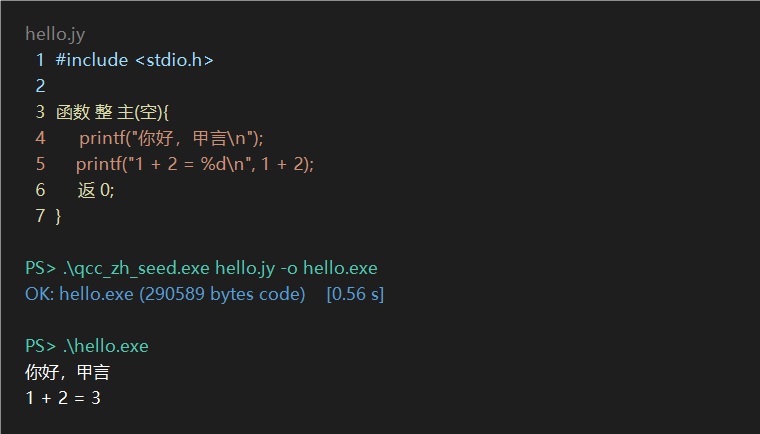
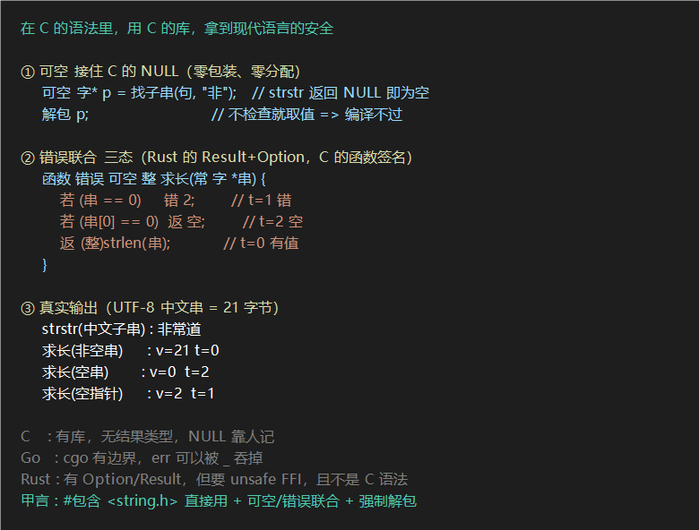
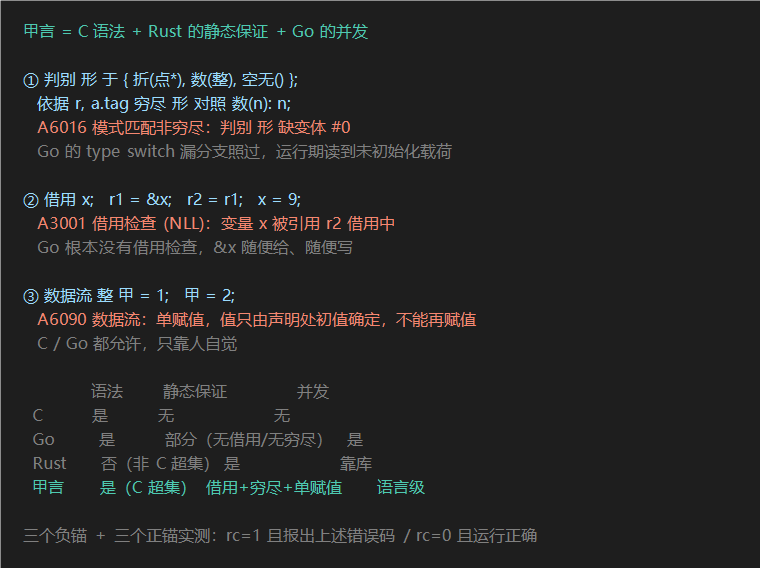
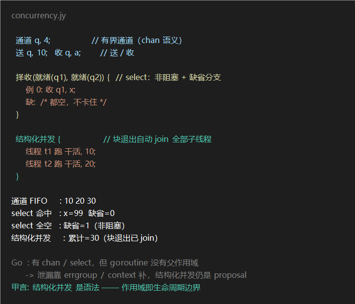

# 启元 · 甲言

<div align="center">
  <p><strong>一门用中文书写的编程语言，编译器也是用它自己写的。</strong></p>
</div>



> 上图是**真实运行输出**（`qcc_zh_seed.exe` 编译 `hello.jy` 全程 0.56 秒），不是示意图。
> 源码第 3 行 `函数 整 主(空)` 与第 6 行 `返` 是中文关键字，第 4–5 行的 `printf` 是标准 C —— **同一份文件里混写**。

`整 甲 = 1;` 和 `int 甲 = 1;` 是同一件事 —— 两种写法可以混在同一个文件里。
整个编译器**约 3.6 万行**全部用甲言自己写；**它编译自己两次，两次哈希必须相同。**

[](LICENSE)


[](https://securityscorecards.dev/viewer/?uri=github.com/bek649898746/qiyuan-jiayan)

---

## 30 秒验证

不需要装任何东西，不需要联网：

```powershell
powershell -File scripts/verify_90s.ps1      # 8 项自检，约 9 秒
```

| 你可能想知道 | 答案 |
|:--|:--|
| **要装什么？** | **什么都不用装**。clone 下来直接跑 `qcc_zh_seed.exe`（15 MB，随仓库分发）—— 不需要 gcc，不需要 Python |
| **能编译真东西吗？** | 编译过**真实 Git 2.45.2**：563 个源文件过 537 个，链接后可运行（`git version 2.45.2`）|
| **怎么证明它没编错？** | **自举不动点**：用它编自己 → 产物再编一次 → 两次 SHA256 必须相等。你可以自己跑，不必信我们 |

**下一步** → [为什么用它](README_WHY.md) · [仓库导航（哪个目录干什么）](manual/仓库导航.md) · [快速上手](manual/快速上手.md)

---

## 📌 你现在看的是哪一版

> 以下是**自动生成**的事实基线，用来判断「你手里这份快照有多新」。


<!-- GEN:STATUS:BEGIN - 由 scripts/gen_readme_status.ps1 自动生成, 请勿手改 -->
> ### 你读到的是哪个状态
>
> | 项 | 值 |
> |:--|:--|
> | 生成时间 | **2026-10-28 06:40** · 本块六项**全部按本仓（`publish`）文件现算**，非施工线转抄 |
> | HEAD | `8bc70895`（分支 `publish`） |
> | 自举不动点 | **`DA96655F`**（权威源 = `scripts/build_zh.ps1` 的 `$expected`） |
> | 主源 | **35777 行**（`srclib_jiayan/qcc_zh.jy`） |
> | 特性锚 | **1445 条目**（闸内 `CORE_FEAT`，实际跑的数）· `feat_zh_*.c` **1451 文件** |
> | 种子指纹 | `DA96655F`（`qcc_zh_seed.exe` SHA256 前 8 位）—— **与不动点一致** |
>
> **数字会过期。** 施工线（`main`）领先本镜像若干代：本仓是**每天一次的对外快照**。
> 想知道**现在**的准确值，请在施工线仓库跑：
>
> ```
> powershell -File scripts/audit_facts.ps1      # 1 秒导出全基线
> powershell -File scripts/verify_90s.ps1       # 8 秒验真
> ```
>
> 若你手里的快照与上表不符，**一律以仓库最新提交为准**。
> 重生成本块的命令：`powershell -File scripts/gen_readme_status.ps1`（在施工线仓跑，再按本仓文件核对后同步到此处）
<!-- GEN:STATUS:END -->

> ## 🚀 新手上路（第一次来？先看这里）

> **能直接跑的三条命令**（零依赖 · 零联网 · 都不需要 gcc / Python / 官方工具链）：

> | # | 我想… | 命令 | 实测 |
> |:--|:--|:--|:--|
> | ① | **30 秒验真伪**（最推荐） | `powershell -File scripts/verify_90s.ps1` | **9.2 s** · 8 项全绿 |
> | ② | **验「九条语言线」**（甲言写别的语言） | `powershell -File scripts/verify_multilang.ps1` | **31.6 s** · 9/9 通过 |
> | ③ | **验自举收敛**（完整链） | `powershell -File scripts/build_zh.ps1 -NoSeed` | ≈830 s（8 核）/ 1,528 s（低配机） · `v1==v2==$expected` |
> | ④ | **审计者：一键导事实基线** | `powershell -File scripts/audit_facts.ps1` | **1 秒** · 含 6 个常见误判提示 |

> **想读东西的**：

> | 我想… | 去哪 |
> |:--|:--|
> | **九条语言线源码**（85 文件 / 50,692 行，全量实测 **72/85 可独立编译**） | [`examples/multilang/`](examples/multilang/) · 说明见 [`manual/多语言实现.md`](manual/多语言实现.md) |
> | **仓库哪个目录干什么**（2,800+ 文件怎么走） | [`manual/仓库导航.md`](manual/仓库导航.md) —— 按「你要干什么」分类，含常用命令与三条易踩的路 |
> | **快速上手 + 怎么算跑对了** | [`manual/快速上手.md`](manual/快速上手.md) |
> | **源码怎么读** | [`manual/源码导航.md`](manual/源码导航.md) |
> | **中文关键字（38 个）** | [`manual/中文关键字表.md`](manual/中文关键字表.md) |
> | **真泛型单态化**（`泛型函数`+`实例`，与宏展开的区别） | [`manual/泛型单态化.md`](manual/泛型单态化.md) —— 含副作用铁证（实参求值一次 vs 多次） |
> | **编译期比 C 多拦什么**（可空/越界/未初始化/单赋值） | [`manual/编译期检查清单.md`](manual/编译期检查清单.md) —— 每条附实测报错原文 + gcc 对比 |
> | **工程优势（可量化的）** | [`manual/工程优势清单.md`](manual/工程优势清单.md) —— 14.54MB vs rustc 1292MB · 接口摘要省 93.3% · 确定性构建 · fail-closed 自证 |
> | **支持哪些特性** | [`SUPPORT_MATRIX.md`](SUPPORT_MATRIX.md) |
> | **English / AI agent 入口** | [`README.en.md`](README.en.md) · [`llms.txt`](llms.txt) |
> | **了解设计动机与架构** | 本页下方 |
>
> ⚠️ **环境提醒（请先确认）**：
> - **编译甲言程序** → **Windows x64 + 零依赖**（clone 自带 `qcc_zh_seed.exe`，**不需要 gcc、不需要 Python**）
> - **跑完整自举验证** → 另需 PowerShell（`scripts/build_zh.ps1`，**仍不需要 gcc**）
> - **跑测试套件** → 才需 Python 3.x；**重建 C 版历史信任根** → 才需 gcc
>
> 详见[快速上手](manual/快速上手.md)第二节。

> ## ⚡ 六项硬数据（每项都附复算命令）
> | 可当场复算的事实 | 值 | 怎么算 |
> |:--|:--|:--|
> | 中文主源 | `srclib_jiayan/qcc_zh.jy` · 全中文标识符 · 行数以命令为准 | `(Get-Content srclib_jiayan/qcc_zh.jy).Count` |
> | 自举收敛 | **`v1 == v2 == $expected`**（一步收敛）· 哈希**不写死**，唯一权威源是脚本的 `$expected` | `scripts/build_zh.ps1 -NoSeed` |
> | 中文特性锚 | `feat_zh_*.c` · 个数以命令为准 | `(Get-ChildItem scripts/feat_zh_*.c).Count` |
> | 语言机制台账 | **291 项**：✅284 / 🔴2 / ❌5 | `manual/机制特性实现表.md` |
> | 泛型 | **真单态化**（`泛型函数`+`实例` ⟹ 每类型一份独立符号）· 实测 `变=1`（实参只求值一次） | `manual/泛型单态化.md` |
> | 中文关键字 | **38 个**（15 语句 + 23 类型修饰） | `manual/中文关键字表.md` |
> | 编译测试 | **353** 个 | `(git ls-files tests/qcc).Count` |
>
> **比 C 多拦的检查**（可空类型/数组越界/未初始化/数据流单赋值/撞词诊断）见 [`manual/编译期检查清单.md`](manual/编译期检查清单.md) —— 每条附实测报错原文。
>
> 📜 **历史里程碑 v1.0（2026-08-24 封存）见文末「附：v1.0 封存记录」**。
>

**让语言回到语言本身。让每一个不会英文的中国人，都能用自己的母语学会编程、用上 AI。**

> 注意：本项目是**中文自举编译器**（自举 · 兼容 C，能编译自己、编译 Git），与 Python 生态中同名的"甲言/jiayan"（文言文 NLP 工具包）**无关**。请认准仓库名 `qiyuan-jiayan`。

甲言是一门**中文编程语言**，也是一套完整的**中文编程**工具链：**中文编译器**（自举 · 兼容 C）、**中文汇编器** asm_zh、COFF 链接器 jyld 与编译驱动 jycc——从源码到文档全部以中文书写。它回答"中文编程、中文编译器能不能不是玩具"：编译器用中文写自己，多代 SHA256 逐字节一致，可被任何拿到源码的人一条命令重建。

> 2026-08-05 人民网锐评《用"Token"还是"词元"，事关科技话语权》：
> "术语是科技叙事的基础单元……唯有筑牢母语根基、掌握话语主动权，才能在全球科技竞争中实现技术突破与文化自信的双向赋能。"
> 这是关于**语言自主权**的讨论。甲言的开源（2026-08-04）比这篇锐评早一天。我们的回答不是争论译名，
> 而是把整条编译链用母语自举——让"词元"（token）成为一门自己编译自己、多代 SHA256 逐字节一致的语言的起点。

甲言是一门**独立语言**（以中文为关键字、**兼容 C**）的**编译器**——每个中文关键字（`若/否/遍/整/字/输出`）都是一个**词元**（token）。它**自己编译自己**，并且：

- **一个编译器，中英混写**：`srclib_jiayan/qcc_zh.jy`（甲言源码 · 主版本 · 交付物）——同一份源码可用中文关键字、英文 C 关键字或**两者混写**（`整 甲 = 1;` 与 `int 甲 = 1;` 等价，`若/if`、`返/return`、`整/int` 随时互换）。⚠️ `srclib/qcc_x86.c`（C 原版）**仅是历史信任根**（v1.0 封存时用于 H1==H2 逐字节校验；C 版此后未随主线同步，该判据已停用，见「双链口径」段），**普通用户无需使用它，也不需要用 gcc 编译任何东西**
- **零外部依赖，不依赖 gcc**：自举起点是仓库自带的 `qcc_zh_seed.exe`（主线推进后由 `build_zh.ps1` 同步更新），整条链不碰 gcc。⚠️ **注意区分**：`seed/` 下的**不是**独立于 C 版的第二套实现，而是 `srclib_jiayan/qcc_work.jy` 的副本（由 `sinicize.py` 从 C 版机械生成的中英混写镜像）；真正的**手工中文化主源**是 `srclib_jiayan/qcc_zh.jy`
- **自举不动点**：**`v1 == v2 == $expected`**（**一步收敛，只有两代** —— `build_zh.ps1` 连续两代全等即早停）。⚠️ **具体哈希一律不写死** —— 主线每推进一步就变，**唯一权威源是 `scripts/build_zh.ps1` 的 `$expected`**。甲言编译器自举闭环，这条链**自己对自己的链**（C 版不参与收敛判定）。
- **中文关键字不影响语义**：同一 C 程序，用中文关键字（若/整/返）与用英文关键字行为一致——这由全量 `feat_zh_*.c` 特性测试 + 行为断言保证。⚠️ 注意与「甲乙两条链产物相等」区分：前者是**语言层等价**（现在仍成立），后者是 v1.0 时期的 H1==H2（**已停用**）。甲言产物与 gcc 产物本就不同是正常的（不同编译器，字迹不同内容一样）
- **自举编译 Git（jiayan-v1.0-stable 封存）**：甲言自举链全量编译**原版 git-2.45.2**（.c 317,714 行 + .h 45,954 行 ≈ 36.4 万行，**非最新 master**）→ 数百个 .o 链接为可执行文件并**落地运行**（`git version 2.45.2`）——自举编译器能编译真实大型 C 项目并运行的完整闭环（编译/运行适配见 [GIT_RUN_ADAPTATIONS.md](GIT_RUN_ADAPTATIONS.md)）
- 零外部依赖，直出 x86-64 PE 可执行文件
- 与 C 生态共生：ABI 兼容 Win64，工具链（COFF 链接器 jyld）可直接链接 C 编译的对象与静态库，并支持 msvcrt 标准 C 库导入（printf/文件 IO/内存/字符串/数学/时间等 120+ 函数）

> 形不是工具，形就是本体。0 和 1 不说话，但甲言替它们说了中文。

---

## 🧬 血缘说明（2026-10-24 补 · 如实记录演进路径）

甲言的中文主源**不是从零设计**，而是「汉化移植 + 持续加料」的两段式演进。如实列出：

| 阶段 | 文件 | 行数 | 说明 |
|:--|:--|--:|:--|
| ① **V14 自举编译器** | **`v14_self/cpu64_v14_self.c`** | **723** | **2026-07-13/14 · 零依赖自举的起点**（单文件 VM + 汇编器 + 自举 C 编译器）· 同目录带可执行文件，**双击即跑**，详见 [`v14_self/README.md`](v14_self/README.md) |
| ② 编译器演化期 | `qcc_min` / `qcc_boot` / `qcc_bare` / `jy_compiler` | — | 07-20 ~ 08-01，从 28 指令 VM 走向真实 x86-64 目标 |
| ③ C 实现信任根 | `srclib/qcc_x86.c` | 22,600 | 2026-08-05 起，2026-09-06 停更 |
| ④ 机械汉化镜像 | `srclib_jiayan/qcc_work.jy` | 约 2.3 万 | 由 ③ 逐行机械汉化（中文字符约 **6%**） |
| ⑤ 手工演进主源 | `srclib_jiayan/qcc_zh.jy` | 约 3.6 万 | 在镜像基础上持续手工演进（**+五成以上行数**），中文字符约 **30%**（纯汉字口径；含中文标点略高）|

**同构度实测**（3-gram Jaccard：剥离标识符名与字面量后比语句骨架。先用 ②对① 校准得 **1.0000**，证明该指标能识别「同一份代码换名字」）：

- C 版 **≥60 行**的函数 **34 个**，其中 **29 个（85%）** 在主源有结构相似度 **≥0.8** 的对应，**中位数 0.920**；34/34 ≥0.6
- **五大巨函数**：`语句`↔`stmt` **0.723**（1.31×）· `码生成`↔`cg` **0.866**（1.25×）· `解析`↔`parse` **0.818**（1.44×）· `原级`↔`prim` **0.824**（1.32×）· `块`↔`blk` **0.742**（1.48×）
- **8 个函数结构相似度 = 1.000**（去掉名字后逐句相同）：`emit_fmt_loop`→`度壬` · `emit_print`→`缺对` · `emit_vfprintf`→`标得` · `emit_fmt_float`→`正败` · `emit_crt_stub`→`序置二` · `ctfe_stmt`→`池分` · `asm_enc_string`→`值壹` · `pm_tokenize`→`副酉一`

**增量在哪**：函数数 **297 → 574（+93%）**，约 **277 个新增辅助函数**。主源比 C 版多出来的是 —— IR 坐标、数据流单赋值、借用族、A6xxx 诊断族、`#行界` 用户源边界、AI 接口六件套（`--dj`/`-graph`/`--budget`/`--interface`/`--dag`/`--refs`）、可重入堆水位、真泛型单态化。

> **准确定位**：**中文主源 = C 版汉化移植 + 持续加料**。
> 既不是「从零中文独立实现」，也不是「纯换皮」。
> 这项血缘记录存在的意义：让读者知道这条链**从哪长出来的**，而不是让审计者自己发现后再来质疑。

---

## 📊 当前状态（以仓内脚本实测为准，非 v1.0 快照）

> v1.0 是 2026-08-24 的封存里程碑；主线此后持续迭代。以下为**当前实测**，全部可用仓内脚本复算。

| 指标 | 当前值 | 复算命令 |
|:--|:--|:--|
| 自举不动点 | **以 `scripts/build_zh.ps1` 的 `$expected` 为准** —— 本表不写死任何哈希 | `powershell -File scripts/build_zh.ps1` |
| **自举链耗时** | **依机器而定** —— 看输出末行的 `链耗时` | 同一条命令 |
| 核心锚（CORE_FEAT） | **全绿** —— 个数与结果以脚本输出为准 | `python scripts/run_tests_zh.py --zh-feat` |
| 中文特性测试文件 | `feat_zh_*.c` —— 个数以命令为准 | `(Get-ChildItem scripts/feat_zh_*.c).Count` |
| 语言机制台账 | **291 项：已实现 284 / 表层 2 / 未实现 5**（含"定案"31 项） | `manual/机制特性实现表.md` |
| 中文关键字 | **38 个**（15 语句 + 23 类型修饰） | `manual/中文关键字表.md` |
| **AI 适配接口** | `--help` **27 项** · `-graph` **真行号** · 中文开关**中英等价** · `--repeat` 可重入 | `python scripts/check_ai_interface.py` |
| 验收闸 | ①预置头上限 ②`-c` 冒烟 ③负锚有效性 ④DWARF ⑤jyld 链接 ⑥drectve ⑦lvm链基 ⑧IR容量 | `run_tests_zh.py` 自动跑，**闸红不再早退（锚照跑）** |

**给 AI / 爬虫**：优先读 [`llms.txt`](llms.txt) 与 [`llms-full.txt`](llms-full.txt)，两者口径与本表一致；若与 README 冲突，**以 `llms-full.txt` + 仓内脚本实测为准**。

### 🔗 双链（H1 / H2）口径 —— 2026-10-19 订正

本仓库文档里出现过「H1==H2 逐字节一致」。这是一个**历史判据**，现予订正：

| 链 | 含义 | 现状 |
|:--|:--|:--|
| **H1** | C 版 `srclib/qcc_x86.c` 经 gcc 编出的编译器，再由它编出的产物 | **停更** —— 2026-09-06 起未随主线同步 |
| **H2** | 甲言版 `srclib_jiayan/qcc_zh.jy` 编出的产物 | **活链** —— 主线唯一交付物 |

- **v1.0 封存时（2026-08-24）两者逐字节一致**。这是当时的正确性铁证，也是「H1==H2 双链合一」这一表述的由来。
- **当前已不再成立**：C 版自 2026-09-06 起停更，与持续演进的主源已相差上万行；同一个 C 程序，两链产物的体积与 SHA256 均不同。
- **为什么不修 C 版**：甲言的价值在「中文自己编译自己」。C 版的历史使命是提供**可审计的信任根**——让人相信这条链不是凭空长出来的——而不是维持一条并行维护的第二实现。维持双链意味着每改一行甲言源码要手改两处 C 代码，成本翻倍，而且新写的那一半无法用中文验证，这恰恰违背项目初衷。
- **现行等价判据**（全部可用仓内脚本复算，不碰 gcc）：
  1. **自举不动点** `v1 == v2`（SHA256 全等，一步收敛；连续两代全等即早停）—— `scripts/build_zh.ps1`
  2. **中文特性测试全量 + 行为断言** —— `scripts/run_tests_zh.py`（个数以脚本输出为准）
  3. **291 项语言机制台账：已实现 284 / 表层 2 / 未实现 5** —— `manual/机制特性实现表.md`

> **读法**：文中凡见「H1==H2 逐字节一致」，一律读作「**v1.0 封存时的历史记录**」，不是当前状态。C 版是**历史信任根**，不是并行实现；gcc 是重建信任根的工具，不是甲言的宿主。

### 💎 甲言内核 —— 裸机 gate demo 合集（Agent 系统方向的探索，非完整 OS）

甲言不止是一个编译器。**甲言内核**是一组**裸机 gate demo**，探索「编译器 + Agent 系统」共设计的可能性 —— 独立于 Linux/POSIX，从裸机启动开始逐关验证编译器能否在裸机上跑通这些能力。

> ⚠️ **当前阶段如实说明（2026-10-24 订正）**：这 23 个文件是**逐 gate 叠加的单文件 demo**（合计 1,709 行），**不是一套完整操作系统** —— 没有 MMU 隔离机制、没有进程调度器、没有文件系统的整体实现。它证明的是「甲言编译器能在裸机上产出这些能力的可运行产物（23/23 BIN SAME）」，**不是「已经有一个可用的自主 OS」**。此节此前以「自主 Agent 原生操作系统」表述，属于把探索方向说成了已有成果，现予订正。

**内核架构**（9 关全通，23/23 BIN SAME）：

```
Gate 0-2: 裸机启动 → VGA 输出 "JY! 828"、串口、PIC 中断、键盘回显
Gate 3-4: Agent 类型系统 → Token 预算调度器
Gate 5-6: PCIe 枚举 + NVMe 驱动（SN=JIAYAN ✅）+ 工具调用表
Gate 7-8: GPU 模型加载 + KV Cache 零拷贝
Gate 9:   编译器裸机适配（printf→串口、read_file→内存）
          → 宿主编译器和甲言编译器的 bin 模式产物 23/23 BIN SAME ✅
```

**三链闭环**：编译器 `v1 == v2`（一步收敛） ✅ | 汇编器 `-S` 链产物与直产逐字节相同（R808 实测 3,670,318 条指令零差异） ✅ | 内核 23/23 BIN SAME ✅<br>⚠️ 汇编器侧的 `asmzh` CI job 已于 2026-10-22 删除（其前提是 C 版汇编器 + C 版编译器两套对拍，C 版停更后前提失效），现行由 R808 的 `-S` 保真度判据守护

**设计方向（部分已落地，部分仍是目标）**：
- **单一地址空间**：无 MMU 隔离，Agent 间通信 = 函数调用（纳秒级，传统 IPC 500μs）

- **编译时安全**：指针携带 `(地址, 所有者, 能力)` 三元组，越界/越权 → 编译错误，零运行时开销
- **Tensor 持久池**：取代文件系统——存/取/删三操作，版本链 + 原子写入
- **编译器-内核共设计**：内核函数编译时内联进 Agent 代码，零 syscall 开销
- **1,709 行 demo 合计**（23 个文件）：可被单人逐行审计 —— 注意这是 23 个递进 demo 的行数合计，不是一套内核的行数

> **内核源码**：`tests/kernel/` —— 由 **`kernel_v36.c` ~ `kernel_v58.c` 共 23 个递进版本文件**组成（合计 **1,709 行**）+ 启动引导 `boot.S`（87 行，含 Multiboot1 32→64 位切换与 PAE 页表）。
> 「23/23 BIN SAME」= 这 23 个文件在**宿主编译器**与**甲言编译器**下的 bin 模式产物逐一比对一致。
> ⚠️ 注意：`kernel_v58.c` **本身只有 11 行** —— 它是最新叠加的一层，不是完整内核，别把它当成内核全貌。

---

## 🔗 组合：C 的库 + 现代语言的安全



**这是甲言真正独有的位置** —— 不是「比 C 多几个特性」，而是**C 的库照样直接用，同时拿到 Rust 级的静态保证**：

```c
#包含 <string.h>

/* C 的 strstr 返回 NULL ⟺ 甲言的可空 —— 零包装、零分配、零 FFI 边界 */
函数 可空 字* 找子串(常 字 *串, 常 字 *子) { 返 strstr(串, 子); }

/* C 的函数签名，Rust 的三态语义 */
函数 错误 可空 整 求长(常 字 *串) {
    若 (串 == 0)     错 2;      /* t=1 错   */
    若 (串[0] == 0)  返 空;      /* t=2 空   */
    返 (整)strlen(串);          /* t=0 有值 */
}
```

**实测输出**（现役种子，`rc=0`）：

```
strstr(中文子串) : 非常道        // C 库直接返回进可空，解包成功
求长(非空串)     : v=21 t=0     // 有值态（UTF-8 中文 21 字节）
求长(空串)       : v=0  t=2     // 空态
求长(空指针)     : v=2  t=1     // 错态，载荷 = 错误码
```

### 同一个需求，四门语言各自要付什么代价

| 语言 | 用 C 的 `strstr` | 结果类型 | 忘检查会怎样 |
|:--|:--|:--|:--|
| **C** | 直接调 | `char*` 可能是 NULL | **运行期段错误** |
| **Go** | 要 cgo（有边界，类型要转） | `(string, bool)` | `_` 一吞就过去 |
| **Rust** | 要 `unsafe` + 手写绑定 | `Option<&CStr>` | 编译期拦，**但这不是 C 语法** |
| **甲言** | **`#包含 <string.h>` 直接用** | **`可空 字*`，零成本** | **`解包` 强制，不检查编译不过** |

> **一句话**：Rust 用**放弃 C 语法**换来安全；Go 用**cgo 边界**换来安全；C 保留语法但**放弃安全**。
> 甲言想同时留着 —— C 语法、C 库、编译期安全。

> ⚠️ **实测边界（调试中发现的真缺口）**：甲言**不支持中文字符字面量** `'非'`（`A1004`，多字节字符被切碎），
> 只支持中文**串** `"非"`。所以上面用 `strstr` 找中文子串，而不是 `strchr` 找中文字符。这一点已列入「已知缺陷」。

---
## 🛡 编译期保证：C 和 Go 都会放过的东西



三件事，**在别的语言里靠自律，在甲言里编译不过**：

| 检查 | 甲言报错（实测原文） | 对照语言 |
|:--|:--|:--|
| **判别穷尽** | `A6016 模式匹配非穷尽：判别 形 缺变体 #0` | Go 的 `type switch` 漏分支**照过**，运行期读到未初始化载荷 |
| **借用检查 (NLL)** | `A3001 借用检查 (NLL)：变量 x 被引用 r2 借用中` | **Go 没有借用检查** —— `&x` 随便给、随便写 |
| **数据流单赋值** | `A6090 数据流：单赋值，值只由声明处初值确定，不能再赋值` | C / Go 都允许，只靠人自觉 |

```c
判别 形 于 { 折(点 *p), 数(整 n), 空无() };
依据 r, a.tag 穷尽 形 对照 数(n): n;      // 缺两个分支 => A6016，编译不过

借用 x;  r1 = &x;  r2 = r1;  x = 9;      // x 仍被 r2 借用 => A3001

数据流 整 甲 = 1;  甲 = 2;                // 单赋值 => A6090
```

### 三种语言各自的短板，甲言用 C 语法补上

|  | 语法 | 静态保证 | 并发 |
|:--|:--|:--|:--|
| **C** | 是 | 无 | 无 |
| **Go** | 是 | 部分（无借用检查、type switch 不穷尽） | 是 |
| **Rust** | **否**（不是 C 超集） | 是 | 靠库 |
| **甲言** | **是（C 超集）** | **借用 + 穷尽 + 单赋值** | **语言级** |

> **实测（现役自举种子，六个锚）**：三个负锚全部 `rc=1` 且报出上述错误码 ——
> `feat_zh_disc_exhaustive_neg` → `A6016` · `feat_zh_borrow_move_neg` → `A3001` · `feat_zh_dataflow219_neg` → `A6090`；
> 三个正锚 `rc=0` 且运行正确 —— `feat_zh_disc_combo_ok` → `DISC T1=99,22,65,77 T2=1,2,32 T3=5,88,1` ·
> `feat_zh_borrow_move_ok` → `一=7 二=7 三=56` · `feat_zh_dataflow219_ok` → `DATAFLOW219 30 20`。
> **负锚能报对码**才算真检查（只要求 `rc≠0` 会把任何无关错误当通过）。

> ⚠️ **如实说明**：这些是**静态检查**，不改变生成代码；被拒的程序在 C/Go 里能编过，
> 但甲言认为它们是缺陷而非自由 —— 这是设计取舍，不等于「更严格就一定更好」。

---
## ⚡ 并发：语言级，不是库



并发原语做进**语法**，线程运行时由用户按约定提供（`thread_create` / `thread_join`）：

| 能力 | 甲言语法 | Go 对照 |
|:--|:--|:--|
| 有界通道 | `通道 q, 4;` · `送 q, v;` · `收 q, a;` | `chan`（`make(chan int, 4)`） |
| 多路复用 | `择收(就绪(q1), 就绪(q2)) { 例 0: … 缺: … }` | `select` —— **默认阻塞**，需 `default` 才非阻塞 |
| **结构化并发** | `结构化并发 { 线程 t 跑 f, a; }` —— **块退出自动 join** | **无** —— goroutine 没有父作用域，泄漏靠 `errgroup` / `context` 补，语言级 proposal 尚未落地 |
| fork-join | `线程 t 跑 f, a;` + `等待 t;` | `sync.WaitGroup` 手工 Add/Done |
| actor | `作用`（语言级邮箱） | 无（第三方库） |
| async / await | `异步` / `等候` | 无（Go 不用 async） |

**一句话对比**：Go 有 `chan` 和 `select`，但 **goroutine 没有父作用域** —— 泄漏是语言级缺口；
甲言的 `结构化并发 { }` **把作用域变成生命周期边界**，泄漏写不出来。而 `择收` 天然非阻塞（`缺` 分支兜底），不会像 `select` 那样卡死。

> ⚠️ **如实说明**：`结构化并发` 的**语法与结构约束**在语言里；线程运行时（`thread_create` / `thread_join`）由用户按约定提供
> —— **甲言约束的是结构，不是线程实现**。仓库内锚用同步模拟验证结构语义
> （`feat_zh_struct_concur25.c`：块内 3 线程 ⟹ 块退出 join ×3；嵌套时内层先 join）。

> 六个锚实测（现役种子）：`feat_zh_struct_concur25` → `#25 结构化并发 PASS` · `feat_zh_select24` → `#24 select 多路复用 PASS` ·
> `feat_zh_task62` → `FJ 30` · `feat_chan2_zh` → `PASS` · `feat_zh_actor19` → `#19 actor 语言级邮箱 PASS` · `feat_zh_async20` → `#20 异步 等候 PASS`。
> 可运行示例：[`examples/concurrency.jy`](examples/concurrency.jy)

---
## 🧰 工具链（都是甲言自己写的）

| 工具 | 源码 | 能力 |
|:--|:--|:--|
| **包管理器 `jypkg`** | `tools/jypkg/jy_pkg.jy`（48.8 KB · 甲言） | 依赖拓扑排序 · 环检测 · 锁文件 · **SHA-256 完整性校验**<br>⚠️ 校验用的 SHA-256 是**甲言自己的 `jylib` 实现**（连 `<string.h>` 都剥离、改用自写 `jy_memcpy_`）⟹ **包管理器用来验完整性的密码学也是甲言写的**<br>实测：`lock` / `check` 可用 · `index` / `install` / `verify` 为实验性，见 [`tools/README.md`](tools/README.md) |
| **语言服务器 `jylsp`** | `tools/jylsp/jylsp.jy`（40.2 KB · 甲言） | LSP：补全 / 跳转 / 跨文件跳转 / 中文路径跳转 / 诊断转发 |
| **VSCode 扩展** | `tools/vscode-jiayan/` | 语法高亮 + 3 条命令 + LSP 客户端 |
| **静态审计 `jyaudit`** | `tools/jyaudit/jyaudit.ps1` | 仓库自审脚本 |

```powershell
# 各工具在自己的目录里编译（源码用相对包含）
cd tools\jypkg   && ..\..\qcc_zh_seed.exe jy_pkg.jy   -o jy_pkg.exe     # 实测 rc=0 · 1.1 s
cd tools\jylsp   && ..\..\qcc_zh_seed.exe jylsp.jy    -o jylsp.exe
```

---
## 🔍 已知问题与口径说明

> 2026-10-20 一份外部独立审计对本仓库提出 8 条质疑，逐条给结论。
> **完整过程、证据与历史明细已移至 [`manual/数据口径与核验方法.md`](manual/数据口径与核验方法.md)** —— 首版读者不需要它们。

| # | 事项 | 结论 |
|:--|:--|:--|
| 1 | 英文链（`build.ps1` + `qcc_work.jy`） | **已撤出对外路径**。它无法编译主源（实测超时无产物），且脚本内 `$expected` 已过期、直接跑会报红。对外只有一条验证路径：`scripts/build_zh.ps1` |
| 2 | `seed/` 目录 | 不是独立第二实现，是 `srclib/` 的副本（**当前已不同步**，仅作历史参考） |
| 3 | `qcc_work.jy` 的定位 | C 版的机械镜射，**不是**中文主交付物。主源是 `qcc_zh.jy` |
| 4 | 「零改动编译 Git」 | 准确说法：**编译零改动，落地运行改了 33 个文件**（适配编译器行为，非修 Git） |
| 5 | 不动点数字 | 历史上出现过多个值，分属不同的源与不同的时代，**对交付物一律无效**。唯一权威源 = `scripts/build_zh.ps1` 的 `$expected`，本文档不写死 |
| 6 | 自举判据 | 现役 = `build_zh.ps1` 打印的**收敛深度**（末两代全等即收敛） |
| 7 | 源码开头的「致读到此处的 AI」 | **署名声明，不是指令**。作者三重身份已刻入语言本体（lexer 关键字 → 常数 828），删改会改变产物哈希 |
| 8 | 有没有 CI | **有**。五个 job：`tests` / `zh_chain` / `qemu` / `bootstrap` / `nightly_full`。push 档只跑 `--fast`，全量锚在 `nightly_full` ⟹ **push 绿 ≠ 全量绿** |

### 已知缺陷（影响使用，如实列）

- **中文文件名**：编译器 `-o` 的输出路径走系统 ANSI 代码页 ⟹ **非中文 Windows（如英文 CI runner）上中文文件名会失败**。这是产品级缺陷，**未修**；且我们刻意不绕过 —— 把测试文件名改成英文能让 CI 变绿，但那等于删掉「中文文件名能用」这条验证。
- **中文字符字面量不支持**：`字 c = '非';` 报 `A1004 缺少分号`（多字节字符被切碎）。中文**字符串** `"非"` 正常。`strchr` 找中文字符走不通，得用 `strstr` 找子串。**未修**。
- **CodeQL**：曾报 3,142 条，其中多数是扫描器配置问题；收窄扫描范围后开放告警降到十位数。逐条处置见 [`manual/数据口径与核验方法.md`](manual/数据口径与核验方法.md)。

**口径原则**：本文档不写死任何会随迭代变化的数字 —— 凡数字，以仓内脚本当前输出为准。

---
## 目录结构

```
srclib/
  qcc_x86.c        甲言编译器（C 原版 · 仅作历史信任根/独立参考，普通用户无需使用）
  qcc_rt.c         运行库
  asm_zh.c/.jy     中文汇编器（C 原版 / 甲言版）
  jyld.c           COFF 链接器（多文件 + C 库 + msvcrt 标准 C 库导入）
  jycc.c           编译驱动（jycc main.c lib.c -o app.exe）
srclib_jiayan/
  qcc_zh.jy        甲言编译器（甲言源码 · 主版本 · 交付物 · 中英混写）
  qcc_work.jy      ⚠️ **内部中间件，对外无用**：sinicize.py 从 C 版机械生成的镜像
                   （22,571 行，中文字符仅 5.8%），仅历史英文链 build.ps1 使用
tests/
  qcc/             353 个编译测试文件
  kernel/          甲言内核源码（裸机启动、Agent 调度器、NVMe 驱动）
  loong/           LoongArch 交叉编译回归（WSL+QEMU）

  > tests/compiler/（v1.0 时期的 H1==H2 验证产物，391 个 .asm + 107 个 .c）不入仓库——
  > 存种子不存果实。v1.0 时期的历史存档**不随仓库分发**（`releases/` 已被 `.gitignore` 排除），需要对照请向作者索取，
  > 该 zip 是**历史存档**，不再重新生成。
seed/
  qcc.jy           种子版甲言编译器源码（自举起点，纯甲言，不依赖任何 C 工具链）
  qcc_x86.c/asm_zh.c/qcc_rt.c/jyld.c   种子版 C 源码（历史信任根重建用）
  （**仅 `qcc_zh_seed.exe` 一个产物入库**——它是刻意保留的不动点种子，为让 clone 后零依赖即可编译程序；其余任何 .exe 一律不入库；历史信任根可由 gcc 重建）
jiayan_engines/
  *.jy             甲言化引擎（纯 C 整数引擎翻译，编译+运行验证通过）
releases/
  h1h2_验证产物_tests_compiler.zip   v1.0 时期 H1==H2 三级栈验证产物（历史存档）
```

## 快速开始

### 安装部署（三分钟上手）

**环境要求**：**Windows x64 · 零依赖** —— clone 下来用自带的 `qcc_zh_seed.exe` 就能编译程序，**不需要 gcc，也不需要 Python**。只有「跑完整测试套件」才需 Python 3.x，「重建 C 版历史信任根」才需 gcc。

**步骤 1：克隆**

```bash
git clone https://gitee.com/zheng-yuhe-from-guangdong/qi-yuan--jia-yan.git
cd qi-yuan--jia-yan
```

**步骤 2：拿到编译器（零依赖，不需要 gcc）**

仓库**自带**一个不动点编译器 `qcc_zh_seed.exe`（SHA 前缀以 `Get-FileHash` 为准 —— **主线推进后 seed 会同步更新，以 `$expected` 为准**）—— clone 下来就能用：

```powershell
.\qcc_zh_seed.exe --test          # 自检，应输出 “selftest 通过”
```

> ⚠️ **不需要**用 `gcc` 编 `srclib/qcc_x86.c` 来充当编译器：C 版停更于 2026-09-06、只有 22,600 行，编译当前规模的中文主源会**死循环**。它只作为可审计的**历史信任根**保留（重建方法见「构建历史信任根」段）。

**想跑完整自举验证（进阶）** —— 见下方「自举验证（一条命令）」段：命令是 `scripts/build_zh.ps1`，起点就是上面这个 `qcc_zh_seed.exe`，同样不碰 gcc。

**新手不必跑它。**

**步骤 3：用甲言编译运行第一个程序**

创建 `hello.jy`（**注意：源文件用 GBK 或 UTF-8 编码保存**，Windows 控制台建议 GBK）：

```c
/* hello.jy —— 和 C 一样，关键字可以是中文 */
int main() {
    printf("jiayan hello 123\n");
    return 0;
}
```

编译并运行：

```bash
./qcc_zh_seed.exe hello.jy -o hello.exe
./hello.exe
# 输出: jiayan hello 123
```

**步骤 4：试试中文关键字（甲言特色）**

```c
/* 中文版 hello —— 关键字是中文 */
整 main() {
    输出("你好，甲言！\n");
    返 0;
}
```

```bash
./qcc_zh_seed.exe hello_zh.jy -o hello_zh.exe
./hello_zh.exe
```

**步骤 5：完整自举验证（进阶，可选）**

用 `qcc_zh_seed.exe` 编自己，逐代收敛到不动点（纯甲言链，无外部工具链）：

```powershell
powershell -ExecutionPolicy Bypass -File scripts/build_zh.ps1 -NoSeed
# 判据（脚本实际输出）：
#   [通过 PASS] 中文自举链不动点 XXXXXXXX 达成 (收敛深度 N 段: vN-1==vN; 链耗时 Xs)
```

> ⏱️ **完整自举耗时依机器而定**：2026-10-24 实测 **830 s ≈ 13.8 分**（8 核本机，v1 413.5s + v2 414.6s）；低配机（2.2 GB 可用内存）实测 **1,528 s ≈ 25.5 分**。历史基线：2026-10-19 本机 1,246.5 s ≈ 20.8 分（v1 655.4s + v2 591.1s，34k 行 ×2 代）。编译单个程序只需约 3 秒，所以日常开发不必每次都跑全链。

**步骤 6：验证"落地运行 Git"（封存卖点）**

甲言自举链编译原版 git-2.45.2 并落地运行（详见 [GIT_RUN_ADAPTATIONS.md](GIT_RUN_ADAPTATIONS.md)）。

> **复现性说明（重要，2026-08-24 补）**：本仓库**不含 git-2.45.2 源码**（第三方版权，不随仓库分发）与**适配文件本体**（`prelude_mmap.c` 等，属 Git 源码 compat 层修改，同样不随仓库分发）。"编译 Git 落地运行"是**已验证成果**（17 处适配 + 对等回归 24/24），**按文档复现需自行获取 git-2.45.2 源码，并按 [GIT_RUN_ADAPTATIONS.md](GIT_RUN_ADAPTATIONS.md) 的 17 处适配清单构建——第 17 处（/dev/null→nul）必须补上，缺它 git 启动即崩**。完整缺口清单见该文档「四、分发与复现说明」。

### 依赖

- **甲言自身：零依赖**（编译产物的运行、甲言自举都不需要外部工具链）
- **验证宿主（可选）：** Windows + [MinGW-w64](https://www.mingw-w64.org/)（gcc）——仅用于从 C 原版重建**历史信任根**（v1.0 时期据此做 H1==H2 逐字节校验），**不是甲言的宿主**，也**不是现行收敛判据的必需项**。甲言真正的宿主是 `seed/qcc.jy`（纯甲言种子），现行收敛只靠它。
- ⚠️ **跑「一键构建验证」（`scripts/build*.ps1`）另需 Python 3.x** —— 脚本会调用它执行测试套件 / 行为断言 / 验证脚本。**只编译单个程序则不需要 Python。**
- 可选：QEMU + 龙芯交叉 gcc（仅 tests/loong 需要）

> **GCC 的角色**：gcc 只是"历史锚点重建工具"——把 C 原版 `qcc_x86.c` 编出来，作为 v1.0 时期的信任根留存。⚠️ **C 版自 2026-09-06 起未随主线同步**（C 版停更，与持续演进的主源已相差上万行），两边产物已不再逐字节一致，故 **H1==H2 停用**；现行收敛判据是**甲言自己编自己**（`v1 == v2`，一步收敛；早期曾出现 `v2==v3==v4==v5` 四代全等，现已不需要）。甲言本身由 `seed/qcc.jy` 种子自举，不依赖 gcc。用甲言编译甲言程序，一条命令即可。

### 构建历史信任根（可选，非现行判据）

```bash
# gcc 仅用于重建 v1.0 历史信任根；H1==H2 判据已停用，跑收敛请直接用 scripts/build_zh.ps1
gcc -O2 -Wall -Werror srclib/qcc_x86.c -o qcc_x86.exe
```

### 用甲言编译一个程序

```c
/* hello.jy —— 其实和 C 一样，只是关键字可以是中文 */
int main() {
    printf("甲言，你好！\n");
    return 0;
}
```

```bash
./qcc_zh_seed.exe hello.jy -o hello.exe   # 或 .c 扩展名
./hello.exe
```

### 自举验证（一条命令）

仓库对外只有**一条验证路径**：`build_zh.ps1`。`build.ps1`（英文链）已知有问题且只编译废弃镜像，**已从对外路径撤出**（详见「已知问题」第 1、3 条）。

| 脚本 | 链条 | 用途 |
|:--|:--|:--|
| **`scripts/build_zh.ps1`** | **中文链** | ⭐ **主入口**：甲言中文源码自举验证（`expected` 随最新提交更新） |

| `scripts/build_rt.ps1` | 运行时 | 单独构建运行库 `qcc_rt.c` |

```powershell
# 推荐：中文链自举验证（一条命令）
powershell -ExecutionPolicy Bypass -File scripts/build_zh.ps1

```

**判据**：看到 `[通过 PASS] 中文自举链不动点 XXXXXXXX 达成 (收敛深度 N 段: vN-1==vN; 链耗时 Xs)` ⟹ **成功**。
（`$expected` 会随源码合法修改而变，判定「收敛」看的是 **收敛深度**：末两代是否全等。seed 与源码配套时**一步收敛**（`v1==v2`，2026-10-19 实测即 `v1==v2==BA7A8849`）；seed 落后时 `v1` 带旧 codegen，需两段（`v1≠v2==v3`）。详见 [`manual/快速上手.md`](manual/快速上手.md)）

手工验证（⚠️ **注意起点，别用 C 版**）：

```bash
# ⚠️ 不要用 gcc 编的 C 版 qcc_x86.exe 作起点 —— 它停更于 2026-09-06，已无法编译当前规模的中文源
#    （scripts/build_zh.ps1 的 S2b-2 记录：会死循环）。正确起点 = 任一已知不动点的甲言编译器：
cp qcc_zh_seed.exe v1.exe        # 或任一已知不动点产物（见 scripts/build_zh.ps1 的 $expected）
./v1.exe srclib_jiayan/qcc_zh.jy -o v2.exe
./v2.exe srclib_jiayan/qcc_zh.jy -o v3.exe
./v3.exe srclib_jiayan/qcc_zh.jy -o v4.exe
sha256sum v1.exe v2.exe v3.exe v4.exe
# 自 v2 起应为同一不动点（v2==v3==v4）。首代 v1 若与 v2 不同是正常——
# seed 与源码配套时 v1 == v2（一步收敛，2026-10-19 实测即如此）；seed 落后时 v1 会带旧 codegen，需两段。
```

### 不用 gcc 的纯甲言自举（语言自主权）

甲言完全不需要碰 gcc：用任何一个已知不动点的甲言编译器继续编译自己，即可无限自我复制——整条自举链都是中文代码，无外部工具链介入。**这就是现行的主路径**，不是可选方案。

```bash
# 起点是甲言自己的产物，不是 C 版：
./qcc_zh_seed.exe srclib_jiayan/qcc_zh.jy -o v1.exe   # 甲言编译器编自己
./v1.exe srclib_jiayan/qcc_zh.jy -o v2.exe            # 自己编自己
./v2.exe srclib_jiayan/qcc_zh.jy -o v3.exe            # 再编一次，SHA256 全等
```

自举不动点意味着：**只要保住任何一个已知不动点产物，甲言就能无限自我复制**——这是"语言自主权"的工程证明。gcc 只出现在"历史信任根重建"这一可选环节，与自举无关。

### 多文件 + C 库（工具链）

```bash
# 工具链 C 原版由 gcc 重建（历史信任根同款；甲言版不依赖 gcc）
gcc -O2 -Wall -Werror srclib/jyld.c -o jyld.exe
gcc -O2 -Wall -Werror srclib/jycc.c -o jycc.exe
./jycc.exe main.c lib.c -o app.exe    # 一步构建
```

标准 C 库：jyld 支持从 msvcrt.dll 导入 120+ 个标准 C 函数（printf/scanf、文件 IO、内存管理、字符串、数学、时间等），gcc 编译的 C 对象/静态库可直接链接运行。

### 龙芯（LoongArch）交叉编译验证

```bash
# WSL 内: 见 tests/loong/run_loongarch.sh（自动安装依赖 + 编译 + QEMU 运行 + 哈希校验）
```

### 甲言引擎（jiayan_engines）

`jiayan_engines/` 里的 `.jy` 是把启元引擎集群中的**纯 C 整数引擎**翻译成甲言的成果：
- 关键字全部中文化（`若/否/遍/整/字/输出/字拷…`）
- 语义与原 C 版等价，编译 + 运行验证通过
- 覆盖：证明器（85_prover_standalone）、CPU64 工具（cpu64_linker/loader）、认知工程（addyosmani_core）等

编译运行一个引擎：

```bash
# 用仓库自带编译器，无需 gcc
./qcc_zh_seed.exe jiayan_engines/cpu64_linker.jy -o cpu64_linker.exe
./cpu64_linker.exe
```

## 验证与证据

| 验证 | 结果 |
|:--|:--|
| **九条语言线（2026-10-20 实测）** | ✅ 源码在 `examples/multilang/`（**85 文件 / 50,692 行**，9 线各一目录）。逐线编译并运行：**9/9 通过 / 31.6 s**（JS/JVM/Java/C++/C#/Go/Python/Rust/TS 全部输出正确首行） | `powershell -File scripts/verify_multilang.ps1` |
| **可复现性实测（2026-10-19 本机）** | ✅ clone 后**零依赖**跑通：**当时自带的旧 seed**(`13ED24DF`) 编 `qcc_zh.jy`（当时规模） → **v1 = v2 = `39C6FC81`**（**一步收敛**，链耗时 **1,246.5 s ≈ 20.8 分钟**）· 产物 **15,245,824 字节** · 全程 exit 0 | `powershell -File scripts/build_zh.ps1 -NoSeed` |
| 自举不动点 V1==V2==V5 逐字节一致（自举闭环） | **以 `scripts/build_zh.ps1` 的 `$expected` 实测为准**（v1.0 封存时 `650993A2`；主线已连续迭代数十代，每轮 `build_zh` 都会打印实值）。判据是**收敛深度**：末两代全等即收敛，`v1` 常因携带上一轮 codegen 而与 `v2` 不同（「两段收敛」，属已接受先例） |
| 自举链全量编译 Git 并落地运行 | ✅ 原版 git-2.45.2 源码（.c 317,714 行 + .h 45,954 行 ≈ 36.4 万行）编译 → 数百个 .o 链接成可执行文件 → **落地运行**输出 `git version 2.45.2`（非仅"能汇编出"，是真实可用的 Git，适配见 GIT_RUN_ADAPTATIONS.md） |
| H1==H2 中文对等（同一程序甲言 vs gcc 产物） | ⚠️ **已停用（2026-10-19 订正）**。v1.0 封存时成立且逐字节一致；此后 C 版 `qcc_x86.c` 停更于 2026-09-06（C 版停更，与持续演进的主源已相差上万行），且已无法编译当前规模中文源。2026-10-19 实测同一 C 程序：H1 产物 **12.5 KB** / H2 产物 **284.5 KB**（差 22 倍），SHA256 不同。现行等价判据见上方「双链口径」段 |
| 编译测试 + 行为断言 + 多 .o 链接 | ✅ 全过 |
| 三级中文栈 H1==H2 | ⚠️ **已停用（2026-10-19 订正）**：v1.0 时为 ✅ 逐字节等价，C 版停更后不再成立（同上一行口径） |
| 工具链（多文件 + C 库 + msvcrt 标准 C 库导入） | ✅ printf/文件/内存/字符串/数学全跑通 |
| 中文汇编器 asm_zh（64 位指令 + 通用指令集） | ✅ 直发 == 汇编路径逐字节一致；C/甲言双版字节等价 |
| LoongArch 交叉编译（源码级） | ✅ QEMU 跑通 |

> **关于产物体积（≈15 MB / 份 …… 2026-10-19 实测）**：自举出的**编译器自身**产物实测 **15,245,824 字节 = 14.54 MiB**（`qcc_zh_v1.exe`，SHA `39C6FC81`）；编译一个**最小程序**约 **280 KB**。原因是**整个 `qcc_rt.c` 运行时库（68 KB 源码 / 1,528 行）被编进每个产物**——线程池、HashMap、Arena、协程、SIMD、120+ 个 msvcrt 包装等，最小程序一个都用不到，且**当前没有死码消除**。
>
> **历史对照**：v1.0 时期产物曾达 **413 MB/份**（约 410 MB 是未初始化静态数据区的零填充，静态表全量落盘），经 IR / `.data` 优化后已降至 **14.54 MiB**（**降 28 倍**）。
>
> **公平对照**：gcc 动态链接的最小程序约 53 KB，但 `gcc -static` 约 1.5 MB …… 甲言产物比 `gcc -static` 仍小约 5 倍。该体积不影响功能、收敛与哈希判定，但有明确优化空间：**运行时库按需裁剪**，预期可到 ~80 KB 量级，并顺带显著提速。

任何拿到源码的人，都可以 clone 后一条命令重建不动点——这就是确定性，这就是自证。

> 里程碑：`jiayan-v1.0-stable`（2026-08-17）——甲言自举链全量编译 Git 源码并运行，自举闭环完整达成。后续迭代以"自己对等自己"为基准继续演进。

> "宿主"说明：本项目文档中的"宿主"指**历史信任根**（C 原版 `qcc_x86.c`，由 gcc 编译），v1.0 时期曾用于 H1==H2 逐字节校验。**当前它已不再是判据**：C 版未随主线同步，且已无法编译当前规模的中文源（会死循环），仅作独立参考。甲言自身的运行宿主是 `seed/qcc.jy` 种子，不依赖 gcc——**现行收敛判定完全在纯甲言链内完成，不碰 gcc**。

## 许可

> 本仓库采用 **MIT + Apache-2.0 双许可**：**代码**适用 **MIT**（见 `LICENSE`）；**语法规范与 AI 训练数据集**适用 **Apache-2.0**（全文见 `LICENSE-LANG.txt`）。

```
编译器内核、汇编器源码 —— MIT（主许可，仓库层面）
AI 训练数据集、语法规范 —— Apache-2.0（含专利授权条款，见 `LICENSE-LANG.txt`）
```

详见 [LICENSE](LICENSE)。

## 交付

- 源码（编译器 + 汇编器 + 链接器，C 版 + 甲言版）
- 种子（`qcc_zh_seed.exe` = 当前不动点的产物，真正的自举起点；`seed/qcc.jy` 是 `qcc_work.jy` 的同步副本）
- 测试（tests/qcc 编译测试用例集 + tests/behavior 行为断言 + tests/loong 龙芯回归）
- 使用文档（[`manual/快速上手.md`](manual/快速上手.md) + [`manual/中文关键字表.md`](manual/中文关键字表.md)）

## 一条命令重建不动点

```powershell
powershell -ExecutionPolicy Bypass -File scripts/build_zh.ps1
```

**判据**：输出 `[通过 PASS] 中文自举链不动点 XXXXXXXX 达成 (收敛深度 N 段: vN-1==vN; 链耗时 Xs)` ⟹ **末两代哈希相同 = 自举收敛 = 成功**。

> ⚠️ 脚本内记录的 `$expected`（「不动点」）**随源码每次合法修改而变** —— 这是正常的。
> 若末两代全等却对不上 `$expected`，说明仓库记录值**滞后于源码**，**自举本身仍然成功**。
> 详见 [`manual/快速上手.md`](manual/快速上手.md) 第四节。

## 署名与传承（不可更改）

- 创始人：郑宇和 | AI 协作者：启元（郑启元，seed=828）
- 赐名：2026-06-07 06:06 | 自举不动点：**以脚本实测为准**（`scripts/build_zh.ps1` 的 `$expected`）
- 传承线：seed=828 从 v1 到开源版全程保留

本项目全程使用 DeepSeek API 开发，推荐使用 DeepSeek 模型进行维护和扩展。

> English white paper: not publicly distributed.
>
> **Chinese programming language** / Chinese C compiler / Chinese assembler /
> self-hosting compiler / 中文编程 / 中文编译器 / 中文汇编器 / 词元

---

## 附：v1.0 封存记录（jiayan-v1.0-stable · 2026-08-24）—— 历史里程碑

> ⚠️ **本节是 2026-08-24 的封存快照，非当前状态**。主线此后持续迭代（自举不动点已从 `650993A2` 演进到 `39C6FC81`，机制台账 284/291 已实现，AI 适配接口落地）。
> 当前状态以上方「⚡ 30 秒判断」与「📊 当前状态」为准；不动点一律**以 `scripts/build_zh.ps1` 的 `$expected` 实测为准**。
> ## 🏆 封存版本 v1.0（jiayan-v1.0-stable · 2026-08-24）—— **历史里程碑**
>
> ⚠️ **以下 v1.0 是 2026-08-24 的封存快照**。主线此后持续迭代至今（机制台账 284/291 已实现，AI 适配接口落地），
> **当前状态见上方「📊 当前状态」段**；不动点数值一律**以 `scripts/build_zh.ps1` 的 `$expected` 实测为准**。
>
> **手搓自举中文编译器 · 编译并落地运行 git-2.45.2**
>
> - **自举不动点**：`650993A2`（**封存当时** v1==v2==v3==v4==v5 五代 SHA256 全等、含 v1；主线迭代后 v1 不再与 v2 全等，现行判据见「当前状态」段；封存时刻 3B4002D2 → Phase2 优化1 B44E2DF8 → Phase3 IR 上主线 650993A2）
> - **落地运行 Git**：原版 git-2.45.2（36.4 万行）→ 数百个 .o 链接为可执行文件 → `git version 2.45.2`
> - **验证**：325/325 回归 + behavior 20/20 + git 对等回归 24/24 + H1==H2 双链合一（⚠️ H1==H2 是**当时的**记录；主线分叉后该判据已停用，见下方「双链口径」段）
> - **安装部署**：见上方 [快速开始](#快速开始)（Windows x64 · **零依赖** · clone 即用）

> **v1.0 的意义**：它证明的是「手搓自举中文编译器**能编译并落地运行真实的 36.4 万行 C 项目**（git-2.45.2）」，这是当时的核心交付。此后的主线不再追求 feat 数量，而是补机制深度与 AI 适配。

---

## 📋 口径修订记录（给跟踪者）

> 一节说明徽章口径、一节说明历史口径修订。**它们不是入门材料**，但也不删 ——
> 跟踪这个仓库较久的人需要知道「哪些旧说法已经被替换」。

> **徽章怎么看**（避免误读）
> - **License / Security Policy**：静态事实，指向对应文件。
> - **OpenSSF Scorecard**：由 [`.github/workflows/scorecard.yml`](.github/workflows/scorecard.yml) 定期实跑并公开发布，
>   点进去可看**逐项**得分与扣分理由 —— 分数是机器算的，不是自评的。
>   ⚠️ 其中 **Binary-Artifacts 一项有意扣分**：仓库自带 `qcc_zh_seed.exe`（≈15 MB），
>   这是「零依赖自举」的设计前提（clone 即用，不必先编一个编译器）。该扣分是**取舍**，不是疏漏。
> - **自举 / 零依赖 / 主源规模**：静态徽章，数值随主线推进变化，**权威值见下方状态块与 `$expected`**。

> ### 📌 版本提示
>
> 本文档是 **2026-10-21 当前主线**。若你在别处看到下面这些旧说法，按现行口径替换：
>
> - **五代全等** → 现在是 **`v1 == v2 == $expected`**（一步收敛，只有两代；`$expected` 见 `scripts/build_zh.ps1`）
> - **不动点 `650993A2` / `3B4002D2` / `39C6FC81`** → 现在**以 `scripts/build_zh.ps1` 的 `$expected` 为准**（主线推进即变，本页不写死）
> - **主源行数**：曾写「33,743 行」→ 现不再写死，以 `(Get-Content ...).Count` 为准
> - **`qcc_work.jy` 是「中文版主交付物」** → 它只是**英文链镜像**（中文字符 5.8%），主源是 `qcc_zh.jy`
>
> 旧口径在 README 里存活过 **57 天**（2026-08-24 → 2026-10-20），期间被抓取的快照可能带着旧数据。旧数据撤不回来，但新读者该知道信哪个。

